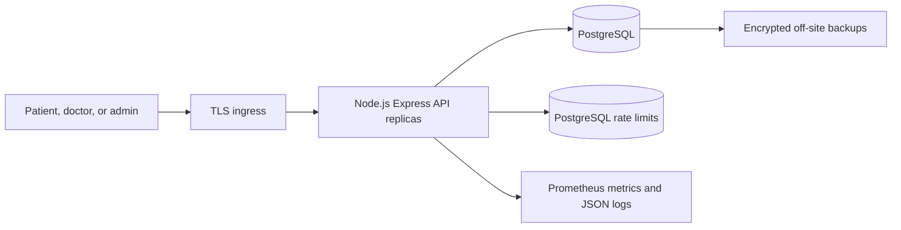

# Architecture and data flows

## Overview



The service is a Node.js modular REST API with PostgreSQL as its only runtime service and source of truth. Fixed-window rate-limit counters are stored in PostgreSQL. Public doctor-directory results are cached in a bounded in-process cache for 30 seconds; clinical records are never cached. HTTP is stateless and horizontally scalable; data consistency, shared rate limits, and appointment locking are handled by PostgreSQL.

The ingress must terminate TLS, set request/body/time limits, and forward only trusted proxy metadata. The application does not enable CORS origins by default. Keep PostgreSQL on a private network and configure production authentication/TLS. The Compose file is optional local development support; its default database password is not for deployment.

## Components and trust boundaries

1. **Clients → ingress:** untrusted traffic, subject to TLS, WAF, DDoS controls, and request-size limits.
2. **Ingress → API:** trusted deployment network; the ingress overwrites forwarding headers rather than accepting client-provided values.
3. **API → PostgreSQL:** parameterized SQL via `pg`; database credentials have least privilege. PostgreSQL owns accounts, profiles, consultations, prescriptions, payment references, and audit records.
4. **API → process cache:** short-lived public directory search results only. PostgreSQL rate-limit counters are shared across API replicas. Directory cache entries are per-instance and can be stale for up to 30 seconds.
5. **Operations telemetry:** request IDs, route, method, status, duration, counters, and histograms only. Request bodies, query strings, tokens, and clinical details are not emitted.
6. **External providers:** video, payment, notification, and identity services are not implemented here. Add only after security/privacy review and do not call them inside clinical database transactions.

## Booking transaction

```mermaid
sequenceDiagram
    participant Patient
    participant API as Node.js API
    participant DB as PostgreSQL
    Patient->>API: POST /appointments + Idempotency-Key
    API->>DB: Increment IP rate-limit bucket
    DB-->>API: Within limit
    API->>API: Validate identity, time, duration, payload
    API->>DB: BEGIN; lock patient row
    API->>DB: Check patient-scoped idempotency key and payload hash
    alt Existing identical booking
        DB-->>API: Return existing appointment
    else New booking
        API->>DB: Lock accepting doctor profile
        API->>DB: Check active appointment overlaps
        alt Slot unavailable
            API->>DB: ROLLBACK
            API-->>Patient: 409 conflict
        else Available
            API->>DB: Insert appointment and audit event; COMMIT
            API-->>Patient: 201 scheduled appointment
        end
    end
```

Booking locks the patient row to serialize retries for the patient and the provider-profile row to serialize overlapping booking checks for one provider. The patient-scoped unique constraint is a final guard for duplicate idempotency keys; canonical UTC payload hashes reject changed payloads using the same key. Active appointment overlap checks and insertion occur within one transaction. Run concurrency tests against PostgreSQL before production; evaluate range/exclusion constraints if workload contention warrants it.

## Data model

| Table | Purpose and important relationships |
|---|---|
| `rate_limit_buckets` | Shared per-client fixed-window request counters with expiration. |
| `users` | Patient, doctor, and admin login identities, password hashes, role, account state, encrypted MFA seed. |
| `doctor_profiles` | Provider specialization, location, public biography, accepting-patients flag. One profile per doctor user. |
| `appointments` | Patient/provider, start/end timestamps, status, reason, idempotency key and request hash. Indexed by provider/time and patient/time. |
| `prescriptions` | Medication instructions tied to a completed appointment, patient, and issuing doctor. |
| `payments` | Provider reference, amount in minor units, currency, and payment status. Never store card numbers/CVV. |
| `audit_logs` | Actor, action, resource, JSON details, and timestamp. Clinical mutations write an audit event in the same transaction. |

UUID identifiers are used for record IDs. For 100k appointments/day (36.5 million/year), first benchmark indexes, query plans, vacuum, and storage. Consider monthly partitioning of append-heavy audit logs and retention-approved archival. Partition appointment records only after reviewing access patterns and migration/foreign-key implications. Add tenant or residency boundaries if regulation requires them.

## Reliability, scaling, and observability

- `GET /health/live` checks process liveness; `/health/ready` checks PostgreSQL.
- PostgreSQL rate-limit failures return 503; protection does not silently disable.
- `/metrics` exposes Prometheus request counters and histograms by method, route template, and status.
- Logs include request ID, method, path, status, and duration, never HTTP bodies or authorization.
- Node.js replicas share no process-local session state. PostgreSQL row locks coordinate booking and PostgreSQL counters share rate limiting; public search cache is per replica.
- Notifications, video room creation, payment capture, and other side effects should use a transactional outbox with idempotent workers, bounded retry/backoff, and dead-letter handling. These are integration work, not implemented flows.

The target of 100k consultations/day averages about 1.16 bookings/second. Peak requests, retries, searches, and non-booking traffic can be much higher. The requested <200 ms read p95, <500 ms write p95, and 99.95% availability are objectives to validate using representative load and failure tests, not benchmark claims.
